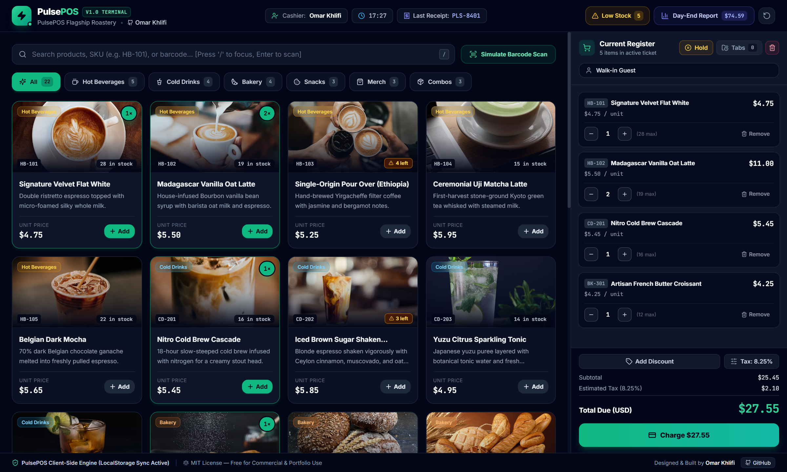
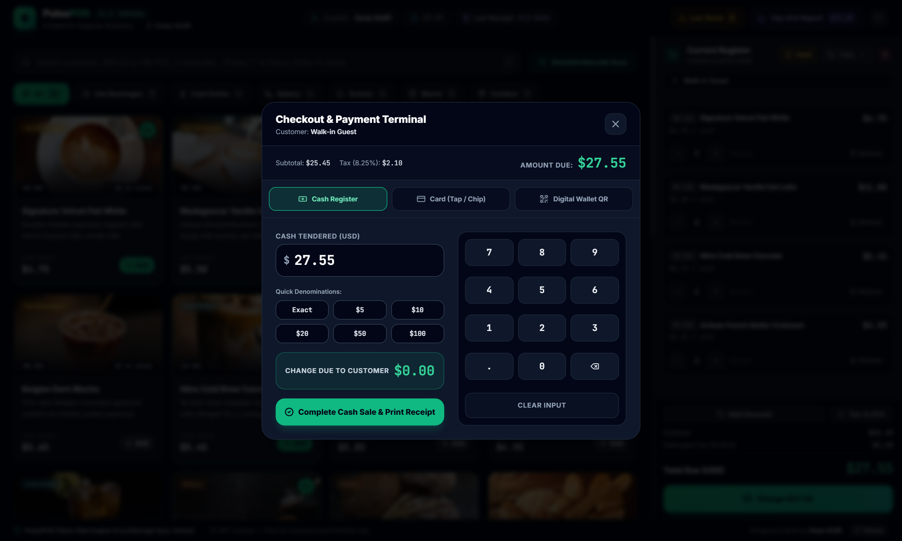
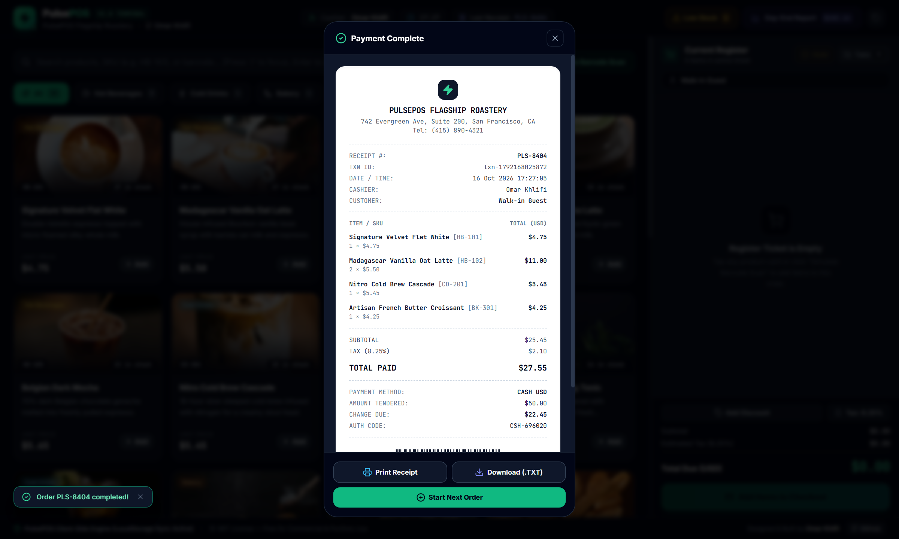
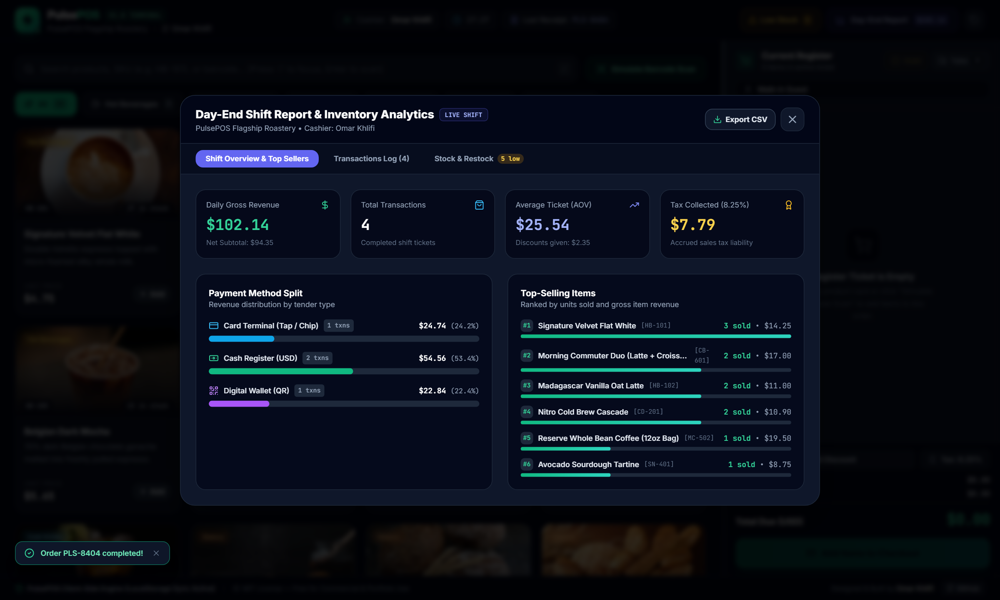

# PulsePOS — Modern Client-Side Point of Sale (POS)


**PulsePOS** is a complete, responsive, zero-backend Point of Sale (POS) web application engineered with **React, TypeScript, Vite, Tailwind CSS, and Lucide Icons**. It runs 100% client-side with automatic `localStorage` persistence and relative static asset paths (`base: './'`) for instant deployment to **GitHub Pages**.

---

## 📸 Screenshots

### 1. Main POS Terminal, Product Catalog & Active Register Order


### 2. Multi-Tender Checkout & Payment Terminal (Cash, Card & Digital Wallet QR)


### 3. Printable & Downloadable Thermal Receipt Modal


### 4. Day-End Shift Report, Revenue Analytics & Inventory Restock


---

## ✨ Key Features

1. **Product Catalog & Barcode/SKU Simulation**
   - Pre-seeded with 22 curated specialty café & retail items across 6 categories (*Hot Beverages, Cold Drinks, Bakery, Snacks, Merch, Combos*).
   - Instant real-time search by name, SKU (`HB-101`), or barcode (`/` shortcut to focus, `Enter` to scan & auto-add).
   - One-click **"Simulate Barcode Scan"** button for hardware laser scanner demonstration.
   - High-resolution Unsplash product imagery with automatic vector **SVG Fallback Skeletons** if offline or blocked.

2. **Split-Screen Register & Multi-Tab Order Management**
   - Interactive line-item quantity steppers (`-` / `+`), unit pricing, and line subtotals.
   - Configurable local sales tax rate (default `8.25%`) and flexible order discounts (`%` or fixed `USD $` + quick presets).
   - **Hold Order / Recall Order** system to park and switch between multiple customer tabs seamlessly.

3. **Checkout & Multi-Tender Payment Terminal**
   - **Cash Register**: Touch numpad, quick bill denominations (`Exact`, `$5`, `$10`, `$20`, `$50`, `$100`), and live change-due calculator.
   - **Card Terminal**: Interactive NFC contactless tap / EMV chip authorization simulation.
   - **Digital Wallet QR**: Dynamic SVG QR code mockup for Apple Pay / Google Pay / PulseQR with instant scan verification.
   - **Printable Thermal Receipt**: Itemized receipt modal with barcode graphic, browser print (`@media print`), and `.TXT` receipt download.

4. **Inventory Tracking & Day-End Analytics Report**
   - Automatic stock decrement upon checkout completion, low-stock warning badges (`< 5` remaining), and quick `+10` restock actions.
   - Day-End shift analytics displaying gross revenue, net sales, average order value (AOV), tax collected, payment method split, top-selling products, transaction history, and CSV export.

---

## 🚀 Quick Start & GitHub Pages Deployment

```bash
# Install dependencies
npm install

# Start local development server
npm run dev

# Build static production bundle (outputs to ./dist with relative paths)
npm run build
```

---

## 📄 License & Author

- **Author:** [Omar Khlifi](https://github.com/omarkhlifi)
- **License:** [MIT License](./LICENSE) — Free for personal, portfolio, and commercial adaptation.
